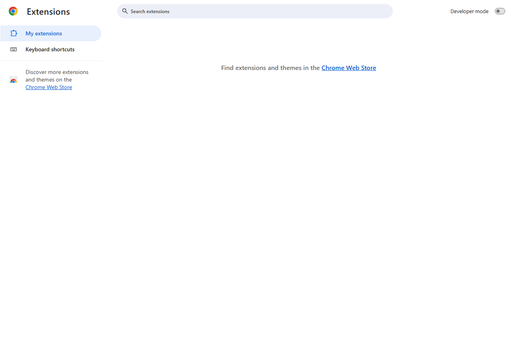
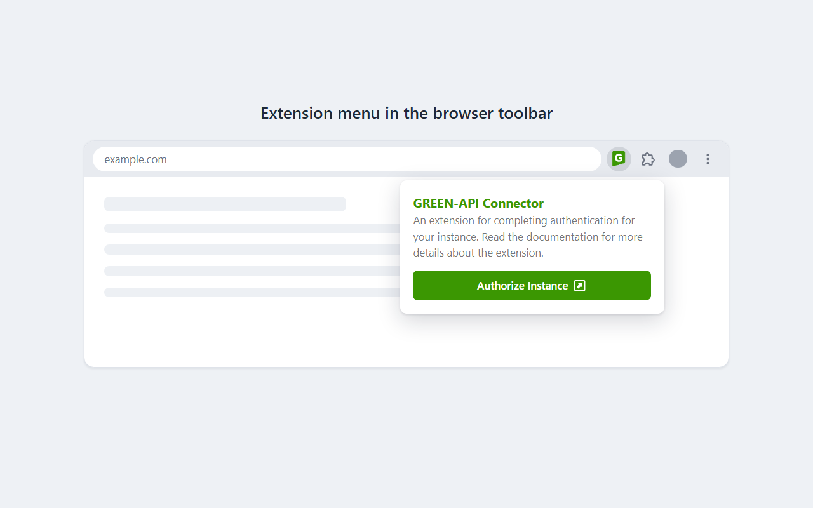
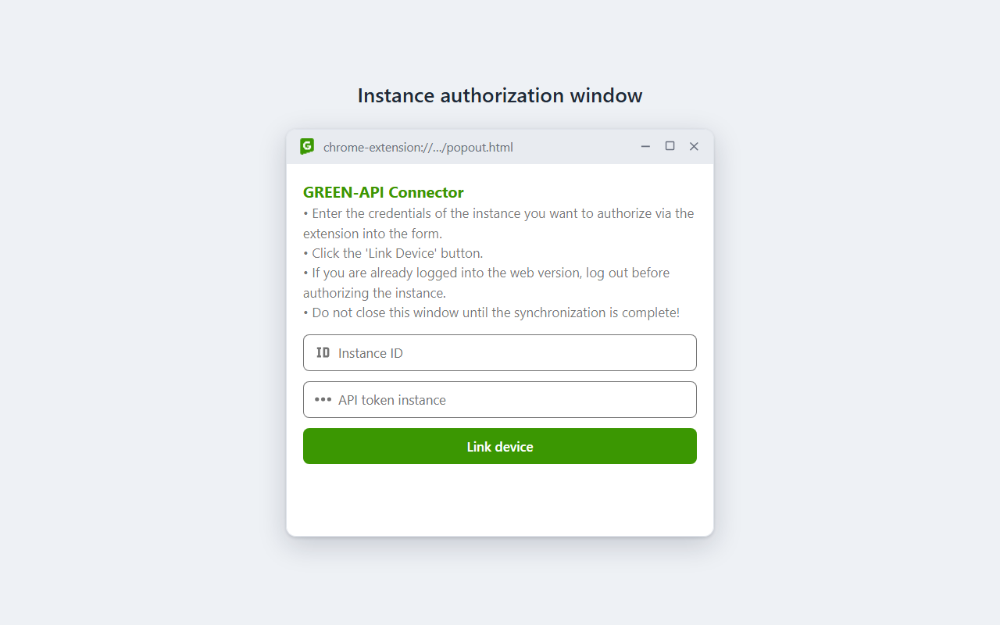

# Installing the extension locally in your browser

[Русская версия](install.browser.ru.md)

These instructions apply to GREEN-API Connector and your own White label extension. First build a release using one of the two scenarios in [Quick Start](../README.md#quick-start). Then install the finished extension in your browser following the instructions below.

## 1. Find the release folder

After the build, the path to the `release/<name>-<version>/` folder (created automatically in the project repository) is printed in the terminal; the brand editor has an **Open extension folder** button.

There are **2 versions of the extension: for Chrome and for Firefox**.

| File or folder | Purpose |
| --- | --- |
| `chrome/` | Extension for Chrome, Edge, Yandex Browser and Opera |
| `firefox/` | Extension for Firefox |
| `*-chrome.zip` | Archive for the Chrome Web Store |
| `*-firefox.zip` | Archive for Firefox Add-ons |
| `preview.html` | Appearance preview; opens without installing the extension |
| `test/` | Test builds and a page for checking communication with the extension |
| `README.txt` | Release instructions |

For local installation, choose the folder for your browser. Do not move or delete the installed extension's folder.

## 2. Install the extension

### Chrome

1. Open a new tab and click **Three dots - Extensions - Manage Extensions**, or type `chrome://extensions` into the address bar and press Enter.
2. Turn on **Developer mode** in the top right corner.

3. Click the **Load unpacked** button that appears.
4. Select the `chrome/` folder from the release. Select the folder itself, not the ZIP archive or the manifest file.
5. Check that the extension card appears in the list and the extension is enabled.

In **Edge**, follow the same steps on the `edge://extensions` page. For Yandex Browser and Opera, also use the build from `chrome/`.

### Firefox

1. Open a new tab and go to `about:debugging#/runtime/this-firefox`.
2. Click **Load Temporary Add-on…**.
3. Select the `firefox/manifest.json` file from the release.
4. Check that the extension appears in the temporary extensions section.

A temporary installation lasts **until Firefox restarts**. A permanent installation requires publishing to Firefox Add-ons.

If you publish your own White label to Firefox Add-ons, enter a **Firefox ID** in the brand editor - a unique add-on ID in one of these formats - `connector@your-company.com` or `@connector` - instead of `@green-api-connector` and rebuild the extension. You do not need to change the ID for a temporary local installation.

## 3. Open the extension menu

Click the extensions icon in the browser toolbar and select your application.

The menu should show the name, the description and the **Authorize Instance** button.

## 4. Start the authorization

1. Click **Authorize Instance**.
2. In the form that opens, enter your instance's ID and API token.
3. Click **Link device** and log in in the WhatsApp window that opens.
4. Do not close the windows until the authorization is complete.

The menu and form images are taken from the preview of the standard GREEN-API Connector. A White label will have your name, logo and colors.

## Troubleshooting

| Problem | What to check |
| --- | --- |
| Installation reports a manifest error | For Chrome, the `chrome/` folder is selected; for Firefox, the `firefox/manifest.json` file. Do not use `dist/` or the other browser's folder |
| The icon is not visible in the toolbar | Open the browser's extensions menu, check that the extension is enabled, and pin the icon |
| The extension disappeared after restarting Firefox | This is expected for a temporary installation: load `firefox/manifest.json` again |
| The local test page shows "Waiting for the extension" | It requires the special debug build from the release's `test/` folder; Chrome also needs access to file URLs. Follow the [guide to integrating the extension into your product](integration.md) |

**Warning!**   
The test page is not needed to authorize through the extension icon. The `test/` folder is for integration testing; **do not publish or distribute the test builds**.
