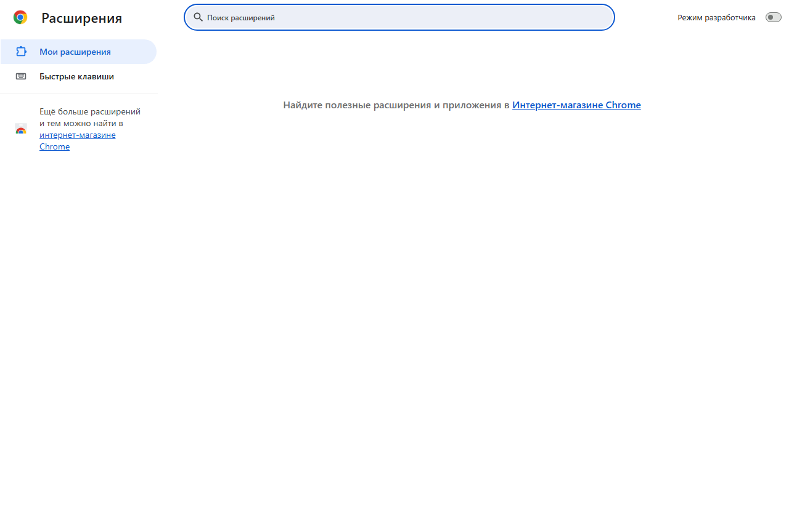
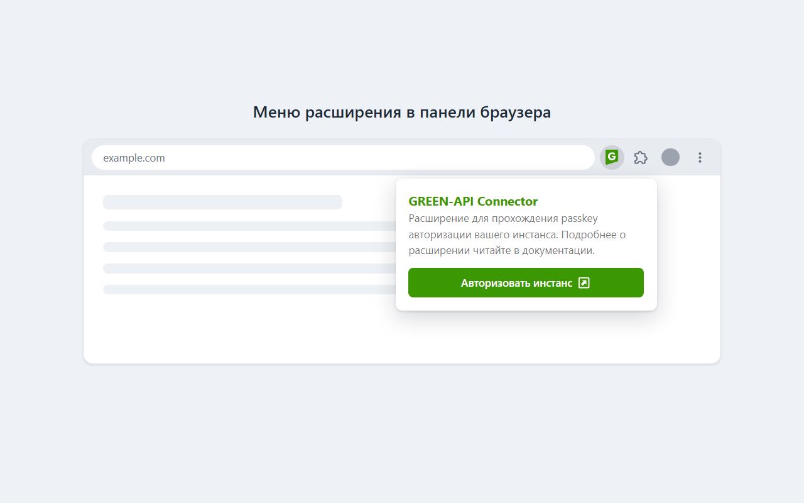
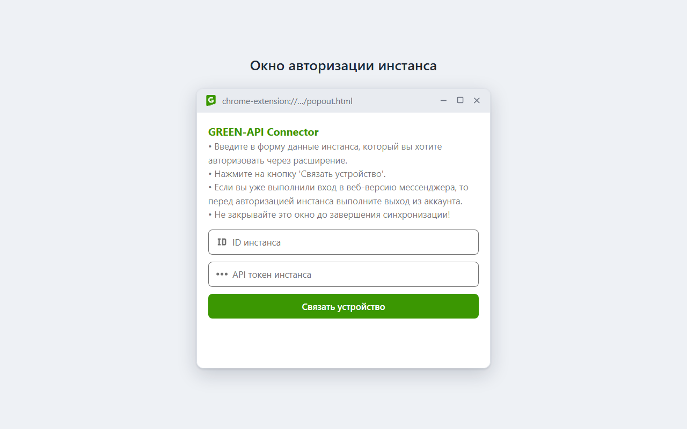

# Локальная установка расширения в браузер

[English version](install.browser.md)

Инструкция подходит для GREEN-API Connector и собственного White label расширения. Сначала соберите релиз по одному из двух сценариев в [быстром старте](../README.ru.md#быстрый-старт). Установите готовое расширение в свой браузер по инструкции ниже.

## 1. Найдите папку релиза

После сборки путь к папке `release/<name>-<version>/` (папка создается автоматически в репозитории проекта) выводится в терминале; в редакторе бренда есть кнопка **«Открыть папку с расширением»**.

Доступны **2 версии расширения: для Chrome и для Firefox**.

| Файл или папка | Назначение |
| --- | --- |
| `chrome/` | Расширение для Chrome, Edge, Яндекс Браузера и Opera |
| `firefox/` | Расширение для Firefox |
| `*-chrome.zip` | Архив для Chrome Web Store |
| `*-firefox.zip` | Архив для Firefox Add-ons |
| `preview.html` | Предпросмотр внешнего вида; открывается без установки расширения |
| `test/` | Тестовые сборки и страница проверки связи с расширением |
| `README.txt` | Инструкция к релизу |

Для локальной установки выберите папку своего браузера. Не перемещайте и не удаляйте папку установленного расширения.

## 2. Установите расширение

### Chrome

1. Откройте новую вкладку, нажмите **Три точки - Расширения - Управление расширениями** или введите в адресную строку `chrome://extensions` и нажмите Enter.
2. В правом верхнем углу включите **«Режим разработчика»**.

3. Нажмите появившуюся кнопку **«Загрузить распакованное расширение»**.
4. Выберите папку `chrome/` из релиза. Выбирайте саму папку, а не ZIP-архив или файл манифеста.
5. Убедитесь, что в списке появилась карточка расширения и оно включено.

В **Edge** выполните те же действия на странице `edge://extensions`. Для Яндекс Браузера и Opera также используйте сборку из `chrome/`.

### Firefox

1. Откройте новую вкладку и перейдите на `about:debugging#/runtime/this-firefox`.
2. Нажмите **«Загрузить временное дополнение…»**.
3. Выберите файл `firefox/manifest.json` из релиза.
4. Убедитесь, что расширение появилось в разделе временных дополнений.

Временная установка действует **до перезапуска Firefox**. Для постоянной установки нужна публикация в Firefox Add-ons.

Если публикуете собственный White label в Firefox Add-ons, укажите в конструкторе бренда **Firefox ID** - уникальный ID дополнения в одном из форматов - `connector@your-company.com` или `@connector` - вместо `@green-api-connector` и пересоберите расширение. Для временной локальной установки менять ID не нужно.

## 3. Откройте меню расширения

Нажмите значок расширений на панели браузера и выберите своё приложение.

В меню должны появиться название, описание и кнопка **«Авторизовать инстанс»**.

## 4. Запустите авторизацию

1. Нажмите **«Авторизовать инстанс»**.
2. В открывшейся форме введите ID и API-токен своего инстанса.
3. Нажмите **«Связать устройство»** и пройдите вход в открывшемся окне WhatsApp.
4. Не закрывайте окна до завершения авторизации.

Изображения меню и формы взяты из предпросмотра стандартного GREEN-API Connector. У White label будут ваши название, логотип и цвета.

## Если возникла проблема

| Проблема | Что проверить |
| --- | --- |
| При установке сообщается об ошибке манифеста | Для Chrome выбрана папка `chrome/`, для Firefox — файл `firefox/manifest.json`. Не используйте `dist/` или папку другого браузера |
| Значок не виден на панели | Откройте меню расширений браузера, убедитесь, что расширение включено, и закрепите значок |
| После перезапуска Firefox расширение пропало | Это ожидаемо для временной установки: загрузите `firefox/manifest.json` заново |
| Локальная тестовая страница пишет «Ожидание расширения» | Для неё нужна специальная отладочная сборка `test/` из папки релиза; в Chrome также требуется разрешение доступа к URL файлов. Следуйте [инструкции по интеграции расширения в ваш продукт](integration.ru.md) |

**Внимание!**   
Для авторизации через значок расширения тестовая страница не нужна. Папка `test/` предназначена для проверки интеграции; **не публикуйте и не распространяйте тестовые сборки**.
